# Graphly

Graphly is an issue tracker that treats your plan as a **dependency graph**. Every "blocks / is blocked by" link feeds a scheduling engine, so the board always knows what's stuck, who's holding it up, and — from estimates and dependencies alone — when you'll really ship, and how sure you can be.

**Live:** [graphly.fly.dev](https://graphly.fly.dev) — click **Try the live demo** to get your own sample workspace, no sign-up.

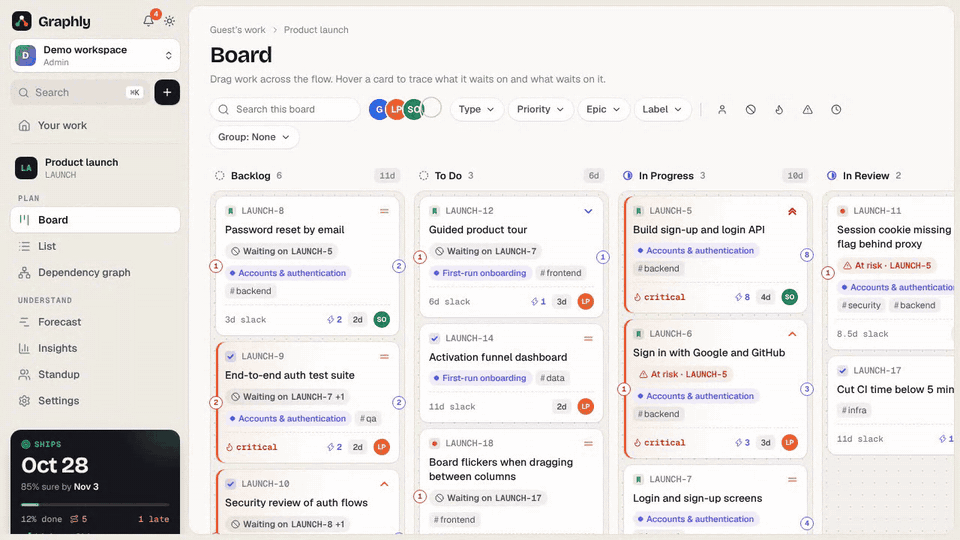

## Why

Trackers store "blocks" links and then ignore them. You can't see which issue is quietly holding up eight others, whether the due date is already lost, or what one slip does to the ship date. Graphly keeps the familiar workflow — projects, issue keys, a board, a list — and puts the graph underneath everything, so those answers are always on screen.

## What it does

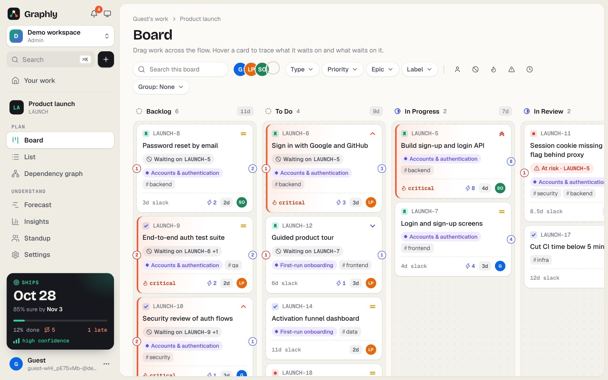

**Cards are graph nodes.** The port on a card's left edge counts the open work it waits on; the port on its right counts what waits on it. Blocked cards name their blocker ("Waiting on APL-5 +1"), and every open card shows its slack — or **critical** in coral when it has none. Hover a card to light up everything upstream and downstream of it.

**The forecast is always in view.** The sidebar carries the ship date, the 85%-confidence date, progress and the length of the critical path, on every page.

### See it in motion

<table>
  <tr>
    <td width="50%">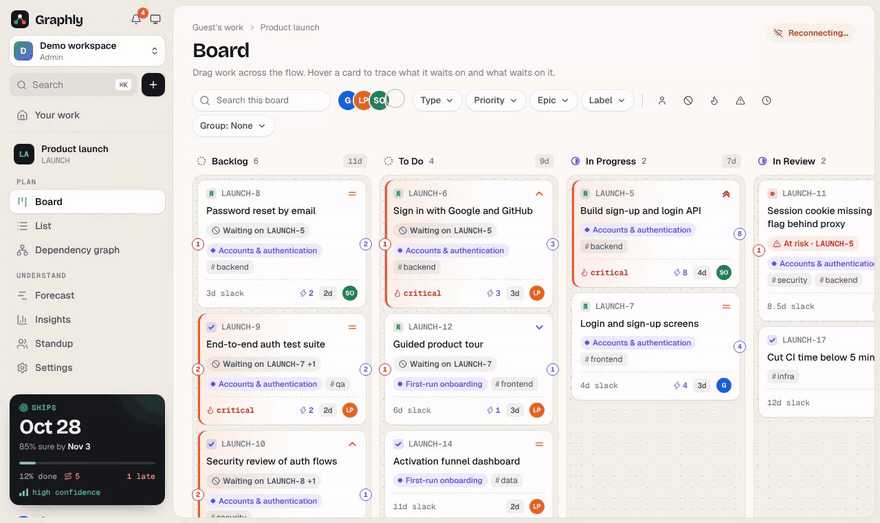</td>
    <td width="50%">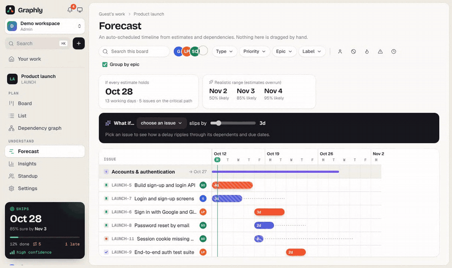</td>
  </tr>
  <tr>
    <td><b>Trace dependencies.</b> Hover a card to light up what it waits on (red) and what waits on it (indigo).</td>
    <td><b>What if it slips?</b> Drag the slider and watch the ship date, dependent bars and due dates move.</td>
  </tr>
  <tr>
    <td>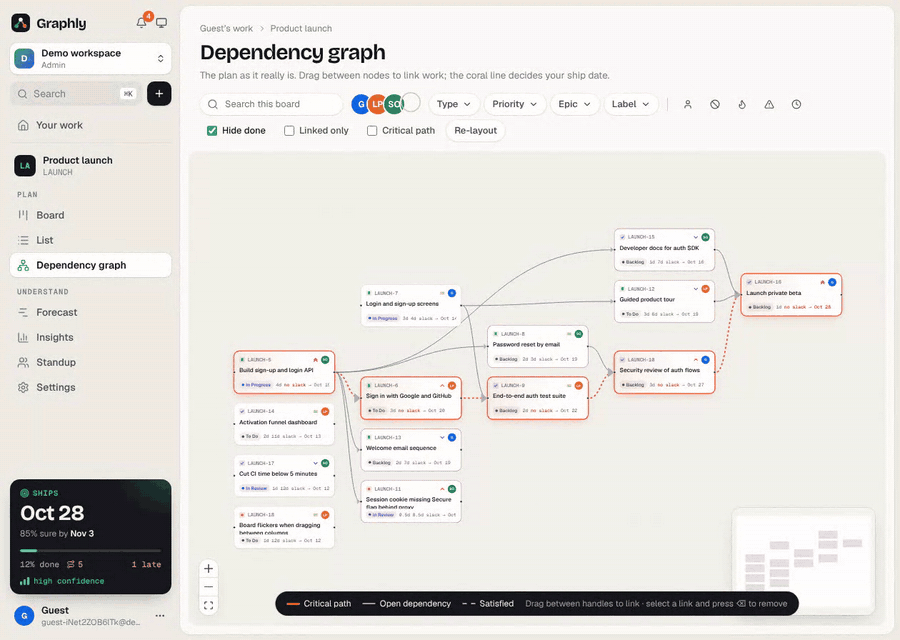</td>
    <td>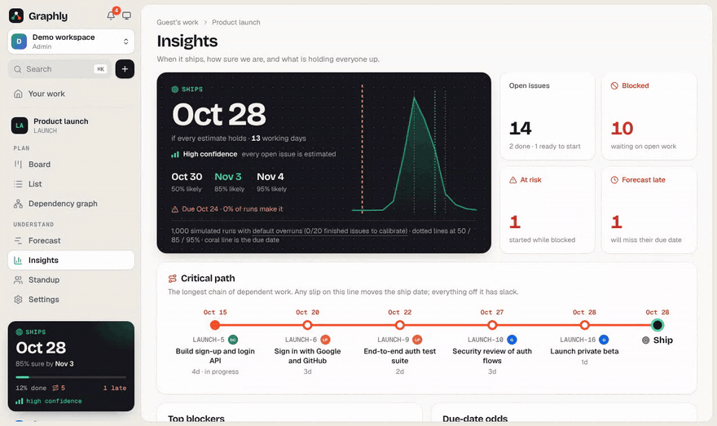</td>
  </tr>
  <tr>
    <td><b>Edit the graph.</b> Drag between nodes to link work. A link that would close a loop is refused.</td>
    <td><b>Know how sure you are.</b> The ship date with its Monte Carlo spread, and the critical path as a transit line.</td>
  </tr>
  <tr>
    <td>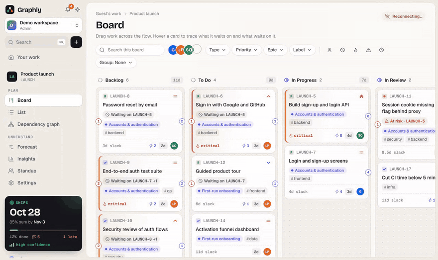</td>
    <td>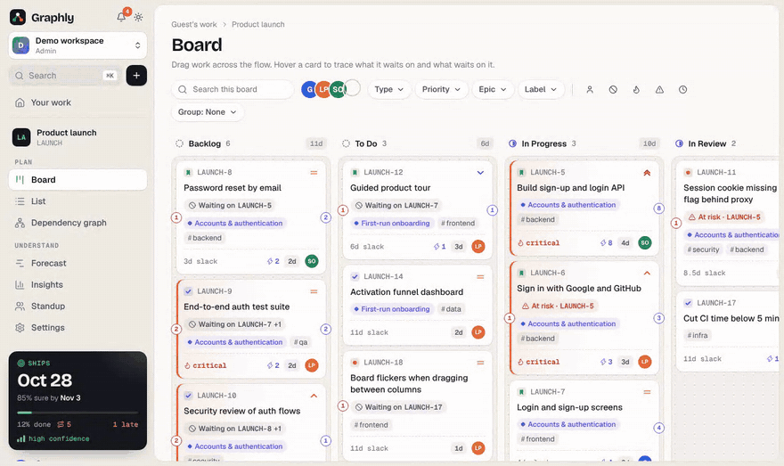</td>
  </tr>
  <tr>
    <td><b>Issues open beside the board.</b> Status, details and the issue's own forecast in one sheet.</td>
    <td><b>Light and dark.</b> Two tuned palettes, not an inversion.</td>
  </tr>
</table>

### New: built for a real team

<table>
  <tr>
    <td width="50%">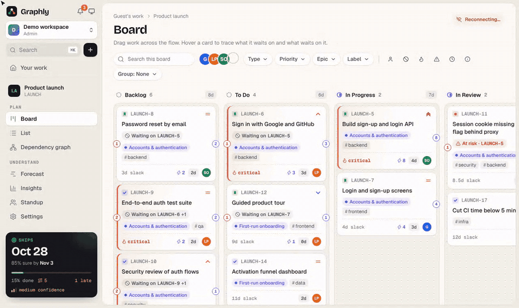</td>
    <td width="50%">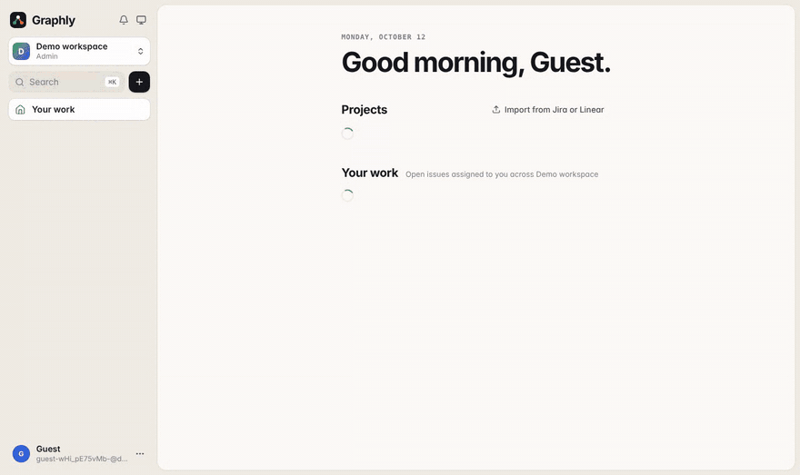</td>
  </tr>
  <tr>
    <td><b>An inbox that knows the graph.</b> You were unblocked, @mentioned, a watched issue moved, your work is now forecast late, the ship date moved. Also by email and Slack digest.</td>
    <td><b>Bring your Jira or Linear plan.</b> A dry run previews every issue and link first, and drops any link that would close a cycle.</td>
  </tr>
  <tr>
    <td>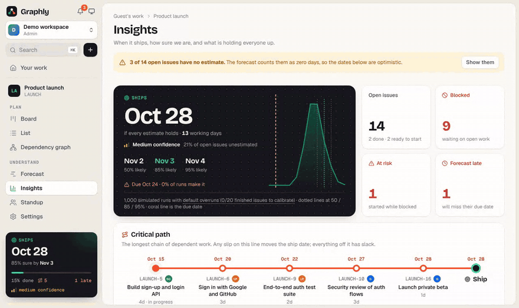</td>
    <td>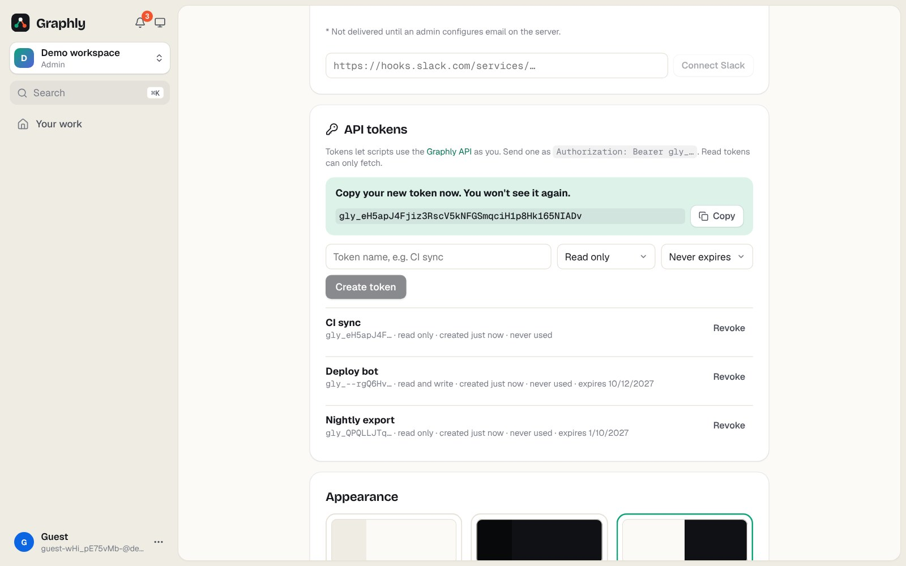</td>
  </tr>
  <tr>
    <td><b>Honest about missing estimates.</b> Unestimated work lowers the confidence badge, and one click lists it.</td>
    <td><b>API tokens.</b> Scoped, expiring, shown once and stored hashed, for scripts that use the <a href="server/openapi.yaml">REST API</a>.</td>
  </tr>
</table>

| | |
|---|---|
| **Forecast dates** | Every open issue gets a start and finish date from the critical path method over working days. Epics finish when their last child does. |
| **Confidence, not a guess** | 1,000 Monte Carlo runs turn one optimistic date into "50% by 19 Oct, 85% by 20 Oct", drawn as a distribution with the due date on it. Overruns start from defaults (bugs overrun most) and, once a project has enough finished work, are calibrated from its own estimate-vs-actual history. Insights says which model is in use. |
| **Estimate quality** | Open issues with no estimate are counted, linked to a filter, and lower a high / medium / low forecast-confidence badge. |
| **Critical path** | The chain that decides the ship date, drawn as a transit line on Insights and in coral across the board, graph and timeline. |
| **Forecast timeline** | An auto-scheduled Gantt chart: bars, slack and due-date markers come from the dependencies, nothing is dragged by hand. |
| **What if it slips?** | Pick an issue and a delay to see the new ship date, every issue that shifts, and which due dates newly get missed. |
| **Blocker intelligence** | Blockers ranked by how much they transitively hold up; "at risk" for work started while blocked; "stale" for blockers nobody has touched in days. |
| **Late before it's late** | Issues whose *forecast* lands after their due date are flagged now, not on the day. |
| **People & bottlenecks** | Load per person split into critical-path and other work, context-switching warnings, and a suggested next task for each person. |
| **Standup** | What shipped, started, got unblocked or newly blocked since the last standup, and a plain-language account of what moved the date. Copies as a text update. |
| **Dependency graph** | A live DAG you edit by dragging between nodes. Cycles are rejected in the UI and, transactionally, on the server. |
| **GitHub and GitLab** | Webhooks link pull/merge requests and commits to issues by key, in the title, branch, description or commit message, and move the issue forward: new branch or commit to in progress, opened to review, merged to done. Issues never move backwards. |
| **Notifications** | An in-app inbox, plus email and Slack digests, for: you were unblocked, @mentioned, an issue you watch changed status, your work is now forecast late, the ship date moved. Per-kind, per-channel preferences. |
| **Import** | Jira and Linear CSV/JSON exports with a dry-run preview. Blocking links included; any that would form a cycle are dropped and reported. Re-running updates instead of duplicating. |
| **Sign-in, API and roles** | Passwords or Google/GitHub. Personal API tokens and a documented REST API (`/api/openapi.yaml`). Viewer / member / admin workspace roles with per-project overrides, and an append-only audit log. |
| **Real time** | Live presence shows who's here and who's viewing an issue; title and description saves use compare-and-swap, so simultaneous edits surface a conflict instead of overwriting. |

Also: workspaces and projects with issue keys (`APL-42`), stories / tasks / bugs / epics, a configurable workflow, swimlanes by assignee or epic, a sortable list, comments and full history, labels, priorities, due dates, filters, a ⌘K command palette, invite links that carry a role, and light / dark / system themes.

<table>
  <tr>
    <td>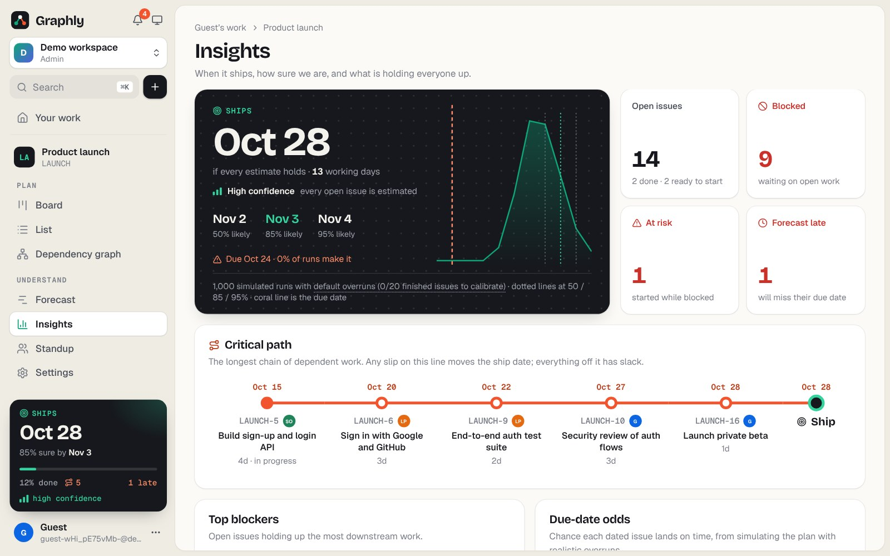</td>
    <td>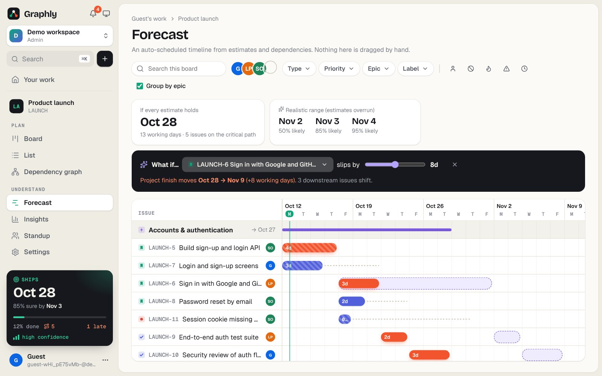</td>
  </tr>
  <tr>
    <td>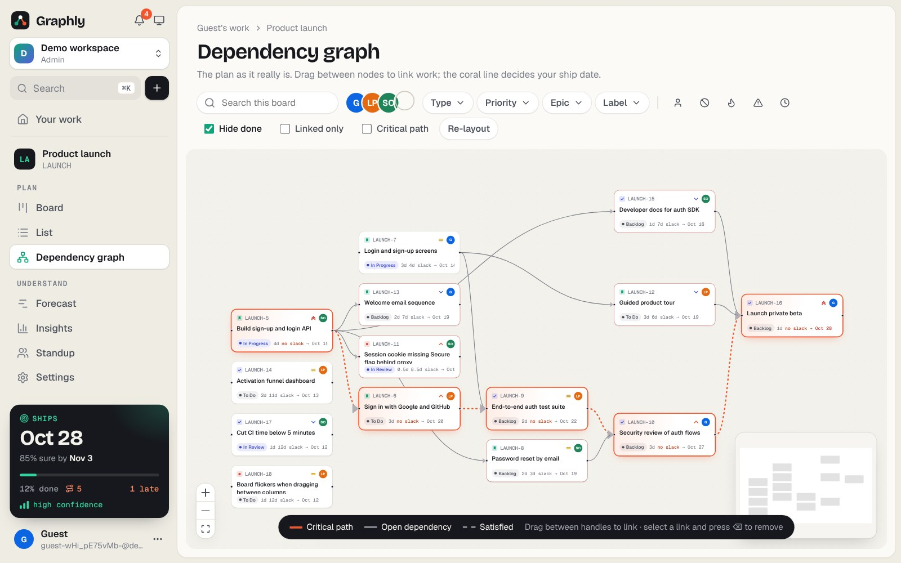</td>
    <td>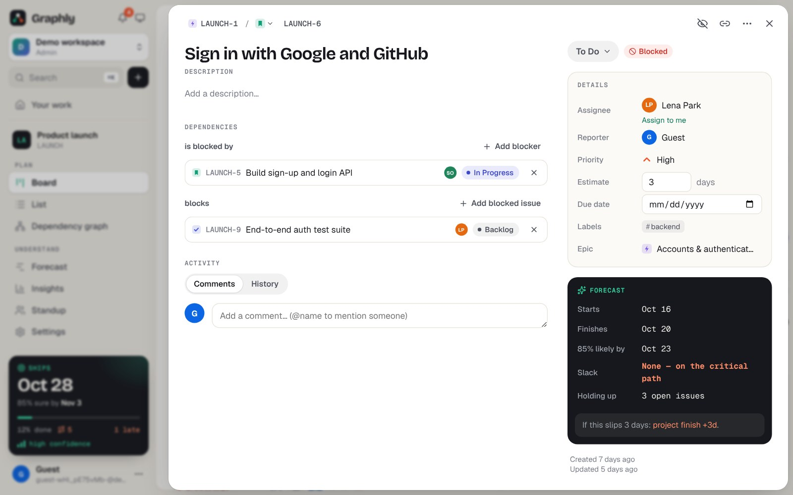</td>
  </tr>
  <tr>
    <td>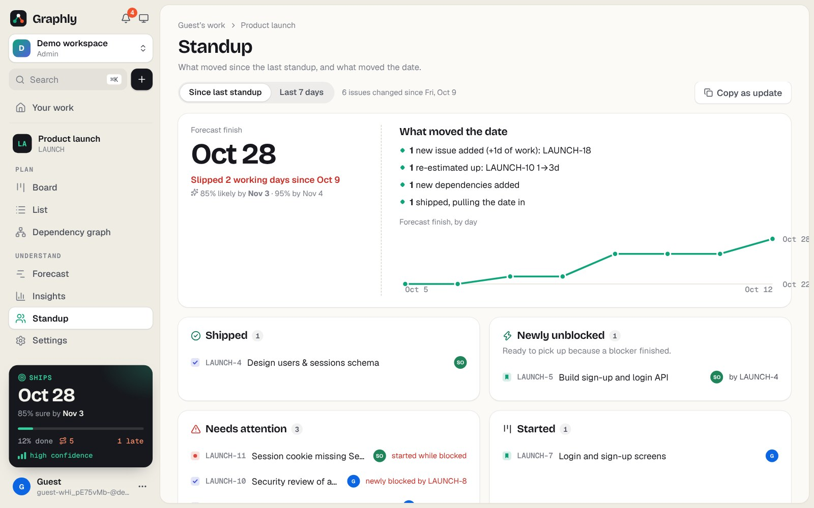</td>
    <td>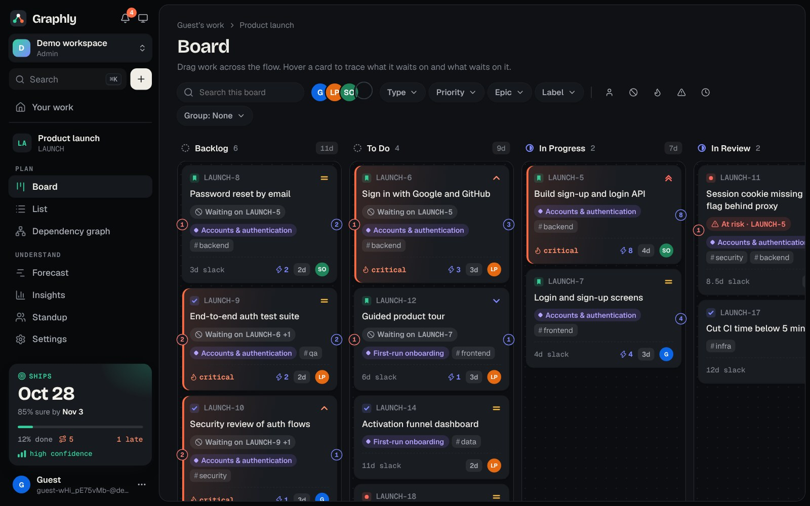</td>
  </tr>
  <tr>
    <td>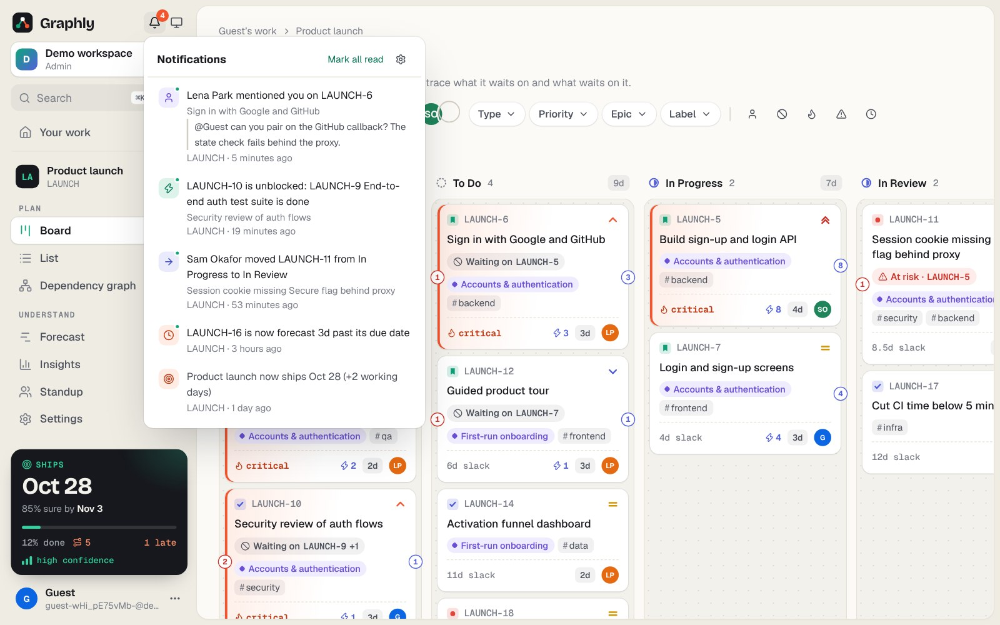</td>
    <td>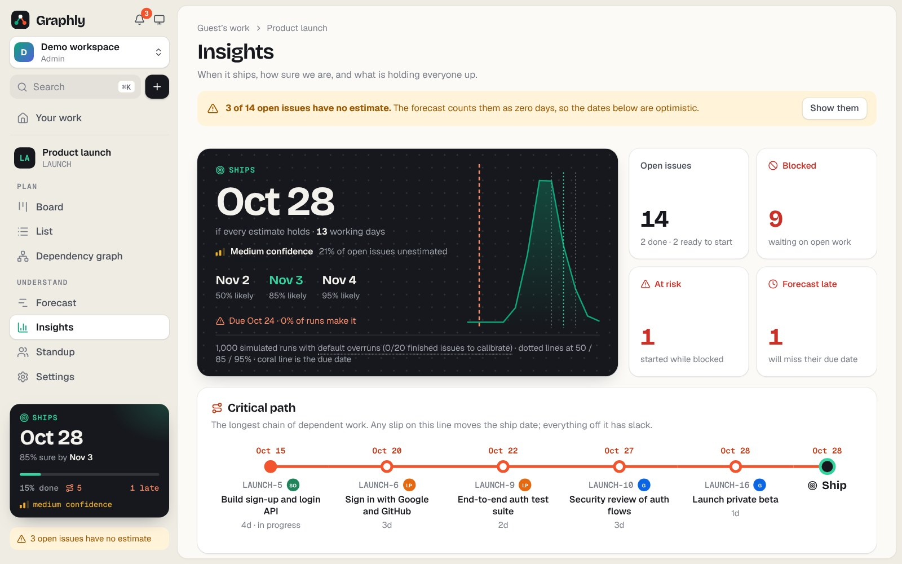</td>
  </tr>
  <tr>
    <td>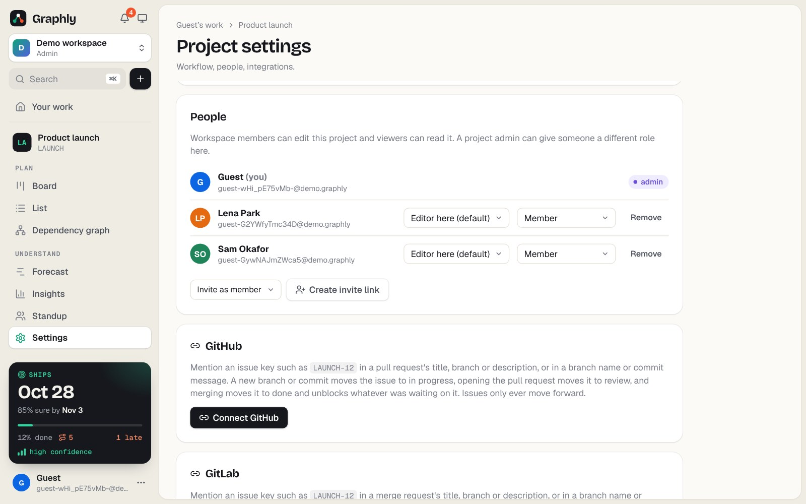</td>
    <td>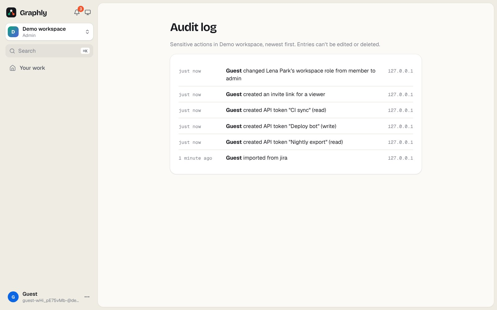</td>
  </tr>
</table>

## Design

Graphly borrows Jira's workflow, not its look. The interface is "graph paper": warm paper and ink in light mode, a tuned ink palette in dark, with one teal accent for progress, **coral reserved for the critical path**, and indigo for everything else that flows. Type is Bricolage Grotesque for headings and numbers, Geist for the interface and Geist Mono for keys and figures. A floating sidebar replaces the top bar, and issues open in a sheet beside the board rather than a modal over it.

## Architecture

```
web/              React + TypeScript (Vite). Runs its own copy of the engine for instant what-if edits.
server/           Go (net/http, pgx, coder/websocket). Postgres is the source of truth.
server/forecast/  The engine in Go: critical path, working-day calendar, seedable Monte Carlo.
fixtures/         Test vectors both engines must reproduce exactly.
```

- **Realtime:** every write records an event in an outbox table in the same transaction, then `pg_notify`s its id. Every server instance `LISTEN`s, and a per-project advisory lock makes event ids commit in order. Clients resume from their last sequence number after a disconnect, on any instance. They're asked to reload if the gap is older than the 24-hour retention window, or if they're ahead of the database, as after a restore. Two or more instances on one database are tested in-process and with `docker compose --profile multi`.
- **Integrity:** adding a dependency locks the project row and checks reachability with a recursive CTE, so two people linking A→B and B→A at the same moment can't create a cycle. `TestConcurrentOppositeLinks` covers this.
- **Forecast:** the server owns it. A background job (one instance at a time, via an advisory lock) records each project's daily forecast. That record drives the Standup view's history and the "now late" and "date moved" notifications. `GET /api/projects/{id}/forecast` returns the current one. The browser runs the same engine (checked against shared fixtures, including a 5,000-issue plan) for instant what-if edits. It no longer reports history.
- **Auth:** bcrypt passwords or Google/GitHub OAuth (PKCE), and random 256-bit session tokens, stored hashed, in an `HttpOnly`, `SameSite=Lax` cookie. API tokens are stored hashed and shown once. State-changing requests require JSON and a same-origin `Origin` header. Roles are enforced on every route and every WebSocket message.
- **Hardening:** rate limits on login, demo, sign-up, writes, imports, webhooks and API tokens. Webhook secret rotation with a grace period. A strict Content-Security-Policy (no inline script or style), HSTS over HTTPS, and size caps on bodies and fields.
- **Notifications:** written in the same transaction as the change, then delivered by email and Slack through an outbox (`SKIP LOCKED`, retries with backoff, digests).
- **Demo:** "Try the live demo" creates a guest account and workspace with a sample project and two teammates. Guests and their workspaces are deleted after seven days.

## Development

Prerequisites: Go 1.26+, Node 22+, Postgres 15+.

```sh
createdb graphly

# API on :8080 (runs migrations on boot)
cd server && go run .

# Frontend on :5173, proxying /api to the Go server
cd web && npm install && npm run dev
```

If port 8080 is taken, run the server with `ADDR=:8090` and the frontend with `GRAPHLY_API=http://localhost:8090 npm run dev`. See `.env.example` for all settings. When you create a project, tick **Include a sample plan** for an 18-issue launch with a due date that's already at risk. `scripts/dev-accounts.example.json` lists throwaway accounts you can sign up with locally to try multi-user presence.

### Tests

```sh
createdb graphly_test
cd server && go test -race ./...   # needs Postgres; wipes graphly_test (TEST_DATABASE_URL to point elsewhere)
cd web && npm test                 # engine, parity with the Go engine, 5k-issue scale budget
```

The Go suite covers the API, auth, roles, realtime across two instances, concurrency, webhooks, import, SSO, tokens, notifications and delivery, rate limits and a 5,000-issue project end to end. CI (`.github/workflows/ci.yml`) runs both suites against Postgres. It also runs `govulncheck`, `npm audit`, a gitleaks scan of the full history, and the two-instance compose check.

To try the UI at scale, generate a project: `cd server && go run . synthetic -workspace <id> -issues 5000`.

## Deploying

The `Dockerfile` builds a single distroless image: the Go binary serves the API, WebSockets and the built SPA.

```sh
docker compose up --build     # Postgres + Graphly on http://localhost:8080
```

The live site runs on **Fly.io** (`fly.toml`, region `sin`) with **Supabase** Postgres:

```sh
fly secrets set DATABASE_URL='postgresql://…:5432/postgres?sslmode=require'
fly deploy
```

Use a direct or session-mode connection, not a transaction pooler: the realtime hub holds a `LISTEN` connection. `fly.toml` already sets `SECURE_COOKIES=true` and `CLIENT_IP_HEADER=Fly-Client-IP`, and checks `/readyz`. Any container host works the same way. Run as many instances as you like against one database.

- **Operations:** [docs/operations.md](docs/operations.md) covers health checks (`/healthz`, `/readyz`), JSON logs with request, user and workspace ids, Prometheus metrics, and suggested alerts.
- **Backups:** [docs/backups.md](docs/backups.md) covers `scripts/backup.sh`, `restore.sh`, the `restore-test.sh` drill, RPO/RTO and the restore runbook.

### GitHub and GitLab integrations

In a project's **Settings**, connect GitHub or GitLab to get a webhook URL and secret.

- **GitHub:** add a repository webhook for **Pull requests** and **Pushes** with content type `application/json`.
- **GitLab:** add a project webhook for **Merge request events** and **Push events**, with the secret as its token.

Regenerating a secret keeps the old one working for `WEBHOOK_SECRET_GRACE` (24 hours by default) while you update the hook. Issues only ever move forward, so a late webhook can't drag finished work backwards.

## Production readiness: what changed

| Phase | Added |
|---|---|
| **1. Correctness and trust** | Server-side forecast (Go port, bit-for-bit with the browser on shared fixtures) and a background job that writes daily history; `GET /api/projects/{id}/forecast`; client-reported history retired (`PUT /snapshot` → 410); seedable Monte Carlo. Estimate-vs-actual recorded per issue and overruns calibrated per type once a project has enough history. Unestimated-work warning, filter and confidence badge. |
| **2. Notifications** | `notifications` table and inbox; unblocked, mentioned, watched-status, now-late and ship-date-moved events; per-user in-app/email/Slack preferences; outbox delivery with retries, backoff, dedupe and digests. |
| **3. Adoption** | Jira/Linear CSV+JSON import with dry run, cycle-safe link import, idempotent re-runs. Google and GitHub sign-in linked by verified email. API tokens, rate limits and an OpenAPI spec. Viewer and per-project roles, enforced on routes and WebSocket messages, with an append-only audit log. GitHub commit/branch linking and GitLab merge requests. |
| **4. Scale, reliability, security** | Multi-instance tests and compose profile (and a fix for out-of-order realtime events). The engine is 5 to 30 times faster at 5,000 issues, with workers, windowed lists and a focused graph for big projects. Structured logs, Prometheus metrics, health checks and alert suggestions. Backup/restore scripts, drill and runbook. Rate limits, secret rotation, CSP/HSTS, input caps, CI with Postgres and security scans. |

New settings, all in `.env.example`:

- **Forecast and calibration:** `FORECAST_TIMEZONE`, `FORECAST_INTERVAL`, `CALIBRATION_MIN_ISSUES`, `CALIBRATION_MIN_PER_TYPE`.
- **Notifications and delivery:** `SHIP_DATE_MOVE_THRESHOLD`, `SLACK_WEBHOOK_HOSTS`, `PUBLIC_URL`, `SMTP_*`, `NOTIFY_DIGEST_WINDOW`, `NOTIFY_POLL_INTERVAL`, `NOTIFY_MAX_ATTEMPTS`.
- **Sign-in:** `GOOGLE_CLIENT_ID/SECRET`, `GITHUB_CLIENT_ID/SECRET`.
- **Rate limits and caps:** `API_TOKEN_RATE_LIMIT`, `WRITE_RATE_LIMIT`, `IMPORT_RATE_LIMIT`, `WEBHOOK_RATE_LIMIT`, `PUBLIC_RATE_LIMIT`, `MAX_ISSUES_PER_PROJECT`.
- **Security:** `WEBHOOK_SECRET_GRACE`, `HSTS_MAX_AGE`.
- **Observability:** `LOG_FORMAT`, `LOG_LEVEL`, `LOG_REQUESTS`, `METRICS_TOKEN`, `METRICS_ADDR`.

Performance at 5,000 issues and 17,000 links (synthetic plan, `fixtures/forecast-scale`):

| | Before | After |
|---|---|---|
| Browser engine: analyze / dates / 1,000-run simulation | 922 / 785 / 1,388 ms | 95 / 12 / 554 ms, with the full simulation in a worker |
| Go engine: analyze / dates | 1,508 ms (467 MB allocated) / 199 ms | 41 ms (18 MB) / 2 ms |
| Timeline view, time to show | 7.2 s (69,500 DOM nodes) | 0.9 s (3,400) |
| Main-thread stall after a status change | about 3 s | about 0.27 s |
| Snapshot / cold forecast / cached forecast endpoint | | 132 ms / 636 ms / 3 ms |

### Not done yet

- **SAML.** Only Google and GitHub OAuth. SAML (or OIDC for any IdP) is the next step for enterprise SSO.
- **API-token import** from Jira/Linear. Import works from exported CSV/JSON files only.
- **OpenTelemetry spans.** Logs carry the `traceparent` trace id; there is no tracing SDK in the binary (see docs/operations.md for how to add one).
- **Shared rate limits.** Limits and the forecast cache are per instance, so N instances allow N times the limit. A shared limiter in Postgres or Redis would make them global.
- **Very large graphs.** The dependency graph view opens big projects focused on the critical path (about 400 issues). "Show all" lays out thousands in a worker, but dagre layout is superlinear and a 4,000-node graph is slow to read anyway. The board pages columns at 100 cards.
- **Slow request bodies.** There is no server-wide read timeout, because it would also cut WebSockets. Bodies are size-capped instead; put a proxy with request timeouts in front.
